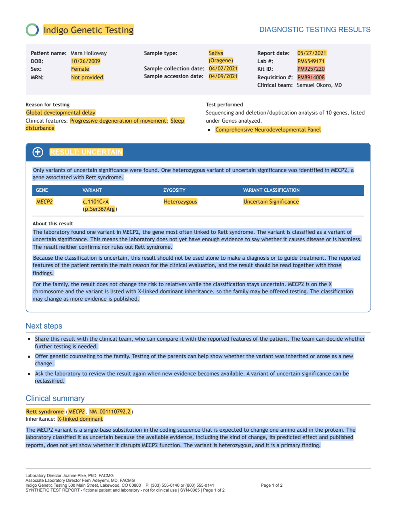

# Gentrex

[](https://github.com/hieutdle/gentrex/actions/workflows/ci.yml)
[](LICENSE)


Gentrex (Genetic Test Report eXtraction) turns clinical genetic test reports
into structured data that you can search, count and share.

Hospitals receive genetic test results as PDFs from many labs, each with its
own layout. The findings sit on a few pages among methods and disclaimers,
so they rarely reach a database. A question such as "which of our patients
carry a pathogenic BRCA2 variant?" then means reading reports by hand.
Gentrex reads the PDFs with open language models on your own GPUs and writes
one record per report, with the patient's details, the overall result, the
clinical features and each reported variant. It adds standard IDs from HGNC,
MONDO and HPO, so reports from different labs can be compared.

You can then load the records into a SQL database, or export them as
Phenopackets, into an OMOP CDM or as FHIR® Bundles.


## What you get

- **Reports stay on your network.** Gentrex runs open models on your own
  GPUs, so no report has to go to an outside service.
- **Any lab's layout.** Language models read each layout, so a new lab needs
  no parser and no template.
- **Most germline tests.** Panels, exomes, genomes, single genes, carrier
  screens, the mitochondrial genome, repeat expansions, copy-number changes
  and karyotypes.
- **Values you can check.** Each field keeps the report's own wording next to
  the standard value, and each variant keeps the page it was found on. A
  record names the values that aren't in the report's text, and the c. and
  p. changes that aren't valid HGVS.
- **Scanned reports too.** Scanned pages, and pages that are only an image,
  go through OCR.
- **Standard formats.** SQL tables with the HPO hierarchy, GA4GH
  Phenopackets, the OMOP CDM and HL7 FHIR Genomics Reporting.
- **Runs you can trace.** Each run records its command, settings, the Gentrex
  version and the git commit, and `--retry` redoes only the pages and reports
  that failed.
- **A benchmark to measure it.**
  [gentrex-bench](#test-gentrex-on-reports-with-known-answers) makes reports
  whose true content is known.

## Running Gentrex

Four commands turn the PDFs into records. Run them in this order:

| Command | What it does | Model and GPU |
| --- | --- | --- |
| [`gentrex transcribe`](docs/user-guide/transcribe.md) | Reads the text of every page. Scanned pages go through OCR. | LightOnOCR-3-4B on one GPU, for scanned pages only |
| [`gentrex select`](docs/user-guide/select.md) | Keeps the pages with the result or the patient's clinical features. Most other pages only describe the test. | Gemma 4 26B-A4B on one GPU with 80 GB |
| [`gentrex extract`](docs/user-guide/extract.md) | Turns the kept pages of each report into one record. | Gemma 4 31B on two GPUs with 80 GB, or one B200 |
| [`gentrex normalize`](docs/user-guide/normalize.md) | Adds ISO dates, categories for the specimen and the result, HGNC IDs, MONDO IDs, HPO terms and, with ClinVar's file, ClinVar IDs. | SapBERT and EmbeddingGemma 2 on the CPU |

The other commands all read the output of `gentrex normalize`, so you run
only the ones you need:

| Command | What you get |
| --- | --- |
| [`gentrex load`](docs/user-guide/load.md) | Tables in SQLite, PostgreSQL or MySQL, with the HPO hierarchy |
| [`gentrex export phenopackets`](docs/user-guide/export-phenopackets.md) | One Phenopacket per patient, for rare-disease tools and other centers |
| [`gentrex export omop`](docs/user-guide/export-omop.md) | Rows in the standard tables of an OMOP CDM in PostgreSQL, for OHDSI tools like ATLAS |
| [`gentrex export omop-extended`](docs/user-guide/export-omop-extended.md) | The same rows, plus extension tables for what the CDM can't hold |
| [`gentrex export fhir`](docs/user-guide/export-fhir.md) | One FHIR Bundle per report, in the HL7® Genomics Reporting format, for an EHR or a FHIR server |

None of these needs a GPU.

A record from `gentrex extract` looks like this, shortened:

```json
{
  "file": "report-01.pdf",
  "pages": [1, 2, 4],
  "data": {
    "mrn": "SYN-MRN-0001",
    "date_of_birth": "06/19/1981",
    "sex": "Female",
    "test_name": "Hereditary Cancer Panel",
    "test_type": "panel",
    "overall_result_raw": "POSITIVE: A pathogenic variant was identified.",
    "patient_phenotypes": [{"text": "Breast cancer at age 38", "present": true}],
    "variants": [
      {
        "page": 1,
        "gene_symbol": "BRCA1",
        "transcript": "NM_007294.4",
        "hgvs_c": "c.5266dupC",
        "hgvs_p": "p.(Gln1756Profs*74)",
        "classification_raw": "Pathogenic",
        "classification": "pathogenic",
        "zygosity_raw": "Heterozygous",
        "zygosity": "heterozygous"
      }
    ]
  },
  "error": null
}
```

Every field is described in
[`schema.yaml`](src/gentrex/defaults/schema.yaml). `gentrex normalize` keeps
the record as it is and adds its standard values in a field named
`normalized`.

## What you need

- [uv](https://docs.astral.sh/uv/), which installs Python and the
  dependencies.
- NVIDIA GPUs with [vLLM](https://docs.vllm.ai) 0.25 or newer, or an account
  on Mount Sinai's Minerva cluster.
- A [Hugging Face](https://huggingface.co) account. Google asks you to accept
  its terms before you can download a Gemma model.
- About 120 GB of disk for the models, and 3 GB more for
  `gentrex normalize`.
- A database for `gentrex load`. SQLite comes with Python. Gentrex is tested
  with PostgreSQL 18 and MySQL 8.4 and refuses
  [other databases](docs/user-guide/load.md#supported-databases).
- An OMOP CDM in PostgreSQL with OHDSI's vocabularies, for the OMOP exports.
  [Get a CDM database](docs/user-guide/export-omop.md#step-1-get-a-cdm-database)
  shows how to set one up.
- [Docker](https://docs.docker.com/get-started/get-docker/), if you run
  PostgreSQL, MySQL or a CDM of your own on your workstation.
- Storage approved for patient data.

## Get started

Work through these pages in order. Each one starts the model server that the
command needs, runs the command and checks its output. Stop each server
before you start the next one.

1. [Transcribe PDF pages](docs/user-guide/transcribe.md)
2. [Select the pages to keep](docs/user-guide/select.md)
3. [Extract report data](docs/user-guide/extract.md)
4. [Normalize report data](docs/user-guide/normalize.md)

Then load or export the records:

- [Load report data into a database](docs/user-guide/load.md)
- [Export report data as Phenopackets](docs/user-guide/export-phenopackets.md)
- [Export report data into an OMOP database](docs/user-guide/export-omop.md),
  with or without [extension tables](docs/user-guide/export-omop-extended.md)
- [Export report data as FHIR Bundles](docs/user-guide/export-fhir.md)

On Mount Sinai's Minerva cluster, the three GPU commands run as batch jobs and
the rest in an interactive session. [Running on Minerva](docs/minerva/minerva.md)
walks you through it.

Each run writes a new folder in `results/`.
[Runs and results](docs/user-guide/runs-and-results.md) explains what's in
it, what the exit codes mean and how to redo only the files that failed.

## Patient data

The reports, and everything Gentrex writes from them, can contain patient
data.

- Keep the Gentrex folder on storage approved for patient data. The reports
  go into `data/` and the results into `results/`. Git ignores both, and
  neither may ever be committed.
- Gentrex sends page images and text to the model servers in `.env`. Run
  them only on machines approved for patient data.
- The same goes for the databases that `gentrex load` and
  `gentrex export omop` write into, including a SQLite file.
- Phenopackets hold the MRN and the date of birth, unless you export them
  with `--pseudonymize` as
  [Share Phenopackets](docs/user-guide/export-phenopackets.md#share-phenopackets)
  explains.

## Test Gentrex on reports with known answers

Real reports can't be shared, so neither can their true content.
gentrex-bench makes synthetic reports instead, each with a truth file that
holds what a perfect run of `gentrex extract` and `gentrex normalize` writes.
Comparing Gentrex's output with the truth files shows which fields it gets
wrong, and on which kinds of report.



- **Real genetics, fictional patients.** The variants, conditions and
  features come from ClinVar, MONDO, HPO and HGNC. Only the patients and the
  labs are made up.
- **21 layouts.** The templates follow the public sample reports of seven
  labs, from panels to karyotypes. Three appear only in the test set, to show
  how Gentrex does on layouts it wasn't tuned on.
- **Five copies of each report.** The native PDF, an office scan, a fax, a
  PDF with some pages scanned, and one made of page images.
- **Known traps.** 18 challenge tags mark what makes a report hard, such as
  IDs that look like the lab number or a variant table split across pages.
- **Public reports too.** A catalog links 77 public sample reports, 61 of
  them within Gentrex's scope, with a script that downloads them.

A version has 300 cases, 100 for tuning and 200 for testing. The scripts in
[`evaluation/`](evaluation/README.md) make the reports, run Gentrex on them
and score the records, on your own machine or on Minerva. A notebook then
follows one report through the four commands and shows the accuracy, time
and tokens of the run, as a whole and for each command.
[gentrex-bench](gentrex-bench/README.md) describes the rest.

## Documentation

The user guide in `docs/user-guide/` has a page for each command, and one
for what they have in common:

- [Transcribe PDF pages](docs/user-guide/transcribe.md)
- [Select the pages to keep](docs/user-guide/select.md)
- [Extract report data](docs/user-guide/extract.md)
- [Normalize report data](docs/user-guide/normalize.md)
- [Load report data into a database](docs/user-guide/load.md)
  - [Database tables](docs/user-guide/database-tables.md)
- [Export report data as Phenopackets](docs/user-guide/export-phenopackets.md)
- [Export report data into an OMOP database](docs/user-guide/export-omop.md)
  - [With extension tables](docs/user-guide/export-omop-extended.md)
- [Export report data as FHIR Bundles](docs/user-guide/export-fhir.md)
- [Runs and results](docs/user-guide/runs-and-results.md)

Running Gentrex on Minerva:

- [Running on Minerva (Mount Sinai)](docs/minerva/minerva.md)

Working on Gentrex itself:

- [Development](docs/development/development.md)
- [Contributing](docs/development/contributing.md)
- [Release a new version](docs/development/release.md)
- [Evaluate Gentrex](evaluation/README.md)
- [Evaluate HPO matching](evaluation/hpo-matching.md)
- [Benchmark design](docs/development/benchmark.md)
- [How the benchmark generator works](docs/development/benchmark-generator.md)
- [Generate benchmark reports](docs/development/generate-benchmark-reports.md)
- [Run the benchmark](docs/development/run-benchmark.md)
- [Download the public sample reports](gentrex-bench/README.md#public-sample-reports)

The [changelog](docs/CHANGELOG.md) lists what changed in each version.

## Cite Gentrex

If you use Gentrex in your research, please cite it. GitHub's "Cite this
repository" button gives the reference from [CITATION.cff](CITATION.cff).

## License

Gentrex is released under the [MIT license](LICENSE).

HL7®, FHIR® and the FHIR [FLAME DESIGN] are the registered trademarks of
Health Level Seven International and their use does not constitute
endorsement by HL7.
