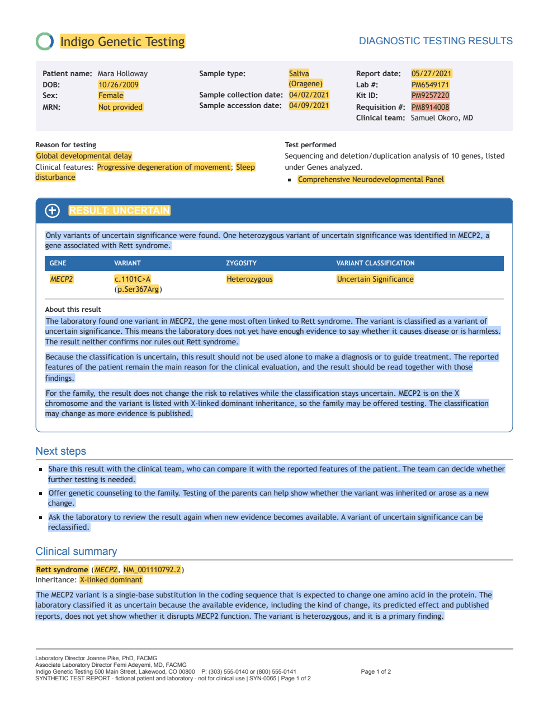

# gentrex-bench

gentrex-bench tests [Gentrex](../README.md) on genetic test reports whose
true content is known. Real reports hold patient data, so nobody can publish
them together with their answers. gentrex-bench makes synthetic reports
instead, each with a truth file, and collects the sample reports that labs
publish.



It has these parts:

| Path | What it holds |
| --- | --- |
| `generator/` | The generator of synthetic reports, which makes each report with a truth file |
| `run.py` | The script that runs Gentrex on the reports and scores the result |
| `scorer/` | The scorer, which compares Gentrex's records with the truth files |
| `public/` | A list of sample reports that genetics labs publish, and a script that downloads them |
| `examples/` | One example report for each template, with its truth file, and the five copies of one report |

The scripts in [`evaluation/`](../evaluation/README.md) run the generator
and `run.py` with one command each, on your own machine or on Minerva, and
[`evaluation_results/pipeline.ipynb`](../evaluation_results/pipeline.ipynb)
shows the scores of all runs as tables and plots.

## What the synthetic reports test

- **Real genetics, fictional patients.** Code picks every value first, from
  ClinVar, MONDO, HPO and HGNC, and a language model writes only the text
  around them. So the truth is exact, and only the patients and the labs are
  made up.
- **21 layouts from seven labs.** The templates follow the public sample
  reports of Ambry, ARUP, Blueprint, Invitae, Labcorp, PreventionGenetics and
  the NHS. Three appear only in the test set.
- **Most germline tests.** Panels, exomes, genomes, single genes, carrier
  screens, the mitochondrial genome, one known variant, microarrays,
  karyotypes, repeat expansions, SMN1 copy numbers and a methylation test.
- **Five copies of each report.** The native PDF, an office scan, a fax, a
  PDF with some pages scanned, and one made of page images.
- **Known traps.** Each case gets one to three of 18 challenge tags, such as
  a relative's feature in the family history or dates in an unusual format,
  so results can be split by what makes a report hard.
- **Checked reports.** Every PDF is checked against its truth before it is
  kept, so a value the truth holds is always printed.

## Make the reports

```bash
uv run python gentrex-bench/generator/generate.py --version v1 sample
uv run --env-file .env python gentrex-bench/generator/generate.py --version v1 build
```

`sample` picks 300 cases and their truth in about half a minute. `build`
needs a model server, which writes the text of each report.
[Generate benchmark reports](../docs/development/generate-benchmark-reports.md)
explains each step, and
[How the benchmark generator works](../docs/development/benchmark-generator.md)
what happens inside. [Benchmark design](../docs/development/benchmark.md)
explains the plan and what it takes from other benchmarks.

## Run the benchmark

```bash
uv run --extra hpo python gentrex-bench/run.py \
  --version v1 --copy native --split dev --gpus 1 1 2 \
  --serve evaluation/local/serve.sh
```

`run.py` runs `gentrex transcribe`, `gentrex select`, `gentrex extract` and
`gentrex normalize` on one copy of the reports and scores the records. It
starts the model server of each command with `serve.sh` and stops it
afterwards. The scores go to `results/gentrex-bench/`, with the report
accuracy, the accuracy of every field, the command that lost each wrong
value, and the time and tokens of each command.
[Run the benchmark](../docs/development/run-benchmark.md) explains the
steps, the scores and the notebook.

## Public sample reports

Labs such as Ambry Genetics, Blueprint Genetics and Labcorp publish sample
reports with made-up patients. `gentrex-bench/public/catalog.csv` lists 77 of
them, with a link to each PDF. The 61 marked `in_scope` are germline tests
that Gentrex's schema covers. The others are tumor profiling,
pharmacogenomics and prenatal screening.

The labs haven't allowed anyone to share their PDFs, so the repository holds
only the links. Download the reports with:

```bash
uv run python gentrex-bench/public/download.py
```

The PDFs go to `data/gentrex-bench/public/pdf/`, named by the catalog's IDs,
such as `AMB01.pdf`. `downloads.json` next to them records the link, size,
page count and checksum of each file. If a file's checksum differs from the
one in the catalog, the lab has changed the report since the catalog was
made, and the script names it in its last line. If a link fails, save the
PDF from your browser under its ID and run the script again. It then
records your copy.

The public reports have no truth files yet. Someone has to read and
annotate each one first.
